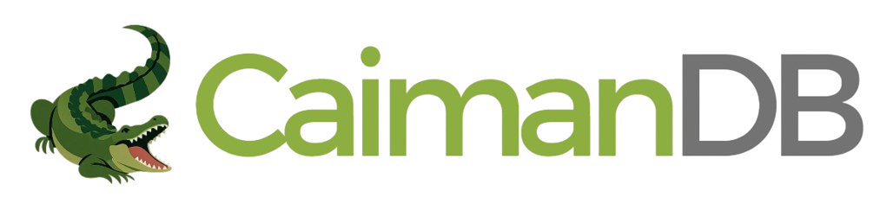
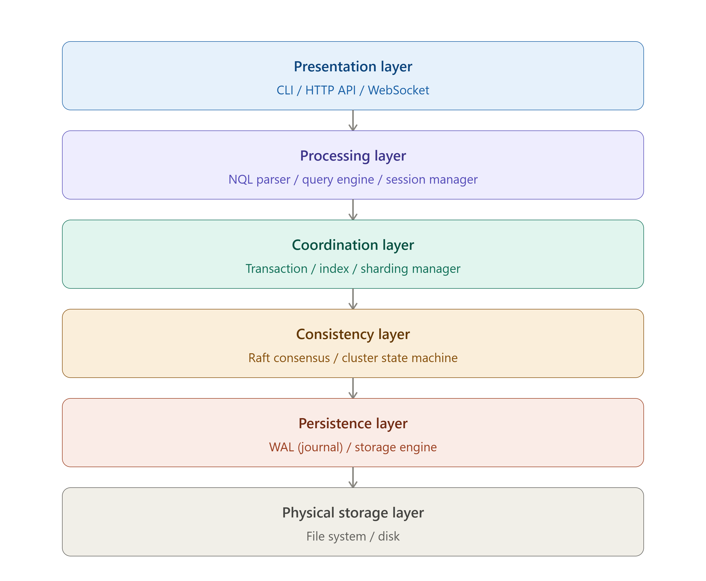

<p align="center">
  
</p>

<h1 align="center">CaimanDB</h1>

<p align="center">
  A document-oriented database engine built around simple queries, durable storage, transactions and distributed operation.
</p>

<p align="center">
  
  
  
  
</p>

## About the project

CaimanDB is an open-source database project focused on making document storage and database administration easier to approach without giving up the foundations needed for serious systems.

The project combines JSON documents with a SQL-inspired query language called **NQL (Native Query Language)**. The engine is designed around durable writes, ACID transactions, recovery through WAL, replication with Raft, sharding and a native administration interface.

CaimanDB is released as **v0.0.1-beta**. The goal of this release is to give the community a real codebase to use, inspect, test, discuss and improve together.

## Why CaimanDB?

Many document databases are easy to start with but can become complex as an application grows. Traditional relational databases provide strong guarantees but can impose a more rigid data model.

CaimanDB takes a different approach:

- JSON documents with flexible fields.
- A readable, SQL-inspired query language.
- ACID transactions and configurable isolation.
- WAL-based durability and crash recovery.
- Raft-based cluster coordination.
- Native sharding and replication components.
- HTTP API, CLI and administration UI.
- Drivers for Go, Java, JavaScript, PHP and Python.
- A codebase intended to be understandable and extensible by contributors.

The project prioritizes **data integrity, consistency and resilience** before optimizing for maximum throughput.

## Current status

**Release:** `v0.0.1-beta`

CaimanDB is an active community-development project. The core engine, NQL implementation, storage layer, transactions, clustering, administration tools and drivers are being developed together.

The beta should be treated as a development release rather than a drop-in replacement for an established production database. Contributions that improve correctness, recovery, documentation, testing, observability and developer experience are especially valuable.

See [`docs/known-limitations.md`](docs/known-limitations.md) and [`ROADMAP.md`](ROADMAP.md) for the current direction.

## Architecture

CaimanDB is organized around several cooperating layers:

```text
Applications
     │
     ├── HTTP API
     ├── Drivers
     ├── CLI
     └── Web UI
          │
          ▼
     NQL / Command Layer
          │
          ▼
     Engine / Transactions
          │
     ┌────┴─────────────┐
     │                  │
   WAL              Storage
     │                  │
     └──────┬───────────┘
            │
     Sharding / Replication
            │
           Raft
```

The detailed architecture is documented in [`docs/architecture.md`](docs/architecture.md).

<p align="center">
  
</p>

## NQL

NQL is CaimanDB's native query language. Its design goal is simple: database commands should be readable without requiring a large amount of ceremony.

Example:

```nql
USE store
CREATE BLOCK products

INSERT products kb001 {"name":"Keyboard","price":49.90,"in_stock":true}
INSERT products {"name":"Mouse","price":19.90,"in_stock":true}

FIND products WHERE price > 20 ORDER price:DESC

UPDATE products WHERE name = "Mouse" SET price = 17.90

COUNT products WHERE in_stock = true

BEGIN store products
  INSERT products {"name":"Webcam","price":39.90}
  UPDATE products WHERE name = "Mouse" SET price = 16.90
COMMIT
```

Complete syntax references are available in three languages:

- [NQL — Español](docs/NQL_SYNTAX.es.md)
- [NQL — English](docs/NQL_SYNTAX.en.md)
- [NQL — Deutsch](docs/NQL_SYNTAX.de.md)

The additional reference is available at [`docs/nql-reference.md`](docs/nql-reference.md).

## Features

### Documents

- JSON document storage.
- Flexible document fields.
- Automatic and explicit indexes.
- Filtering, ordering, pagination and distinct queries.
- Aggregations and grouping.
- Full-text search facilities.
- Relations, joins and views.

### Transactions and durability

- ACID transaction model.
- Repeatable-read isolation support.
- Write-Ahead Log (WAL).
- Recovery and checkpoint mechanisms.
- Backup and restore functionality.
- Crash-recovery test suites.

### Distributed operation

- Raft-based cluster coordination.
- Replication.
- Sharding.
- Cluster administration commands.
- Failover and recovery components.

### Developer experience

- NQL CLI.
- HTTP API.
- Web administration UI.
- Go, Java, JavaScript, PHP and Python drivers.
- Docker deployment files.
- Build and test scripts.

## Quick start

### Requirements

- Go 1.24 or newer.
- Linux, macOS or Windows.
- Git.
- Docker is optional.

### Build

```bash
git clone https://github.com/Horinsoft/caimandb.git
cd caimandb
go mod download
go build ./...
```

Or use the included build scripts:

```bash
# Linux / macOS
./scripts/build.sh

# Windows
build.bat
```

### Run

```bash
./bin/caimandb
```

The administration UI is available at:

```text
http://localhost:1555/
```

Start the CLI with:

```bash
./bin/caimandb cli
```

For a guided first session, see [`examples/quickstart.md`](examples/quickstart.md).

## Project structure

```text
caimandb/
├── cmd/                 Application entry points
├── internal/             Database engine and internal services
├── pkg/                  Public Go packages
├── api/                  API documentation and definitions
├── drivers/              Language drivers
├── docs/                 Architecture, NQL and operational docs
├── examples/             Examples and quick starts
├── deployments/          Docker and deployment files
├── scripts/              Build and development scripts
├── test/                 Integration fixtures and NQL tests
├── ui/                   Web administration interface
├── configs/              Configuration examples
├── CONTRIBUTING.md       Contribution guide
├── CODE_OF_CONDUCT.md    Community standards
├── SECURITY.md           Security reporting policy
├── SUPPORT.md            Support and discussion guide
└── ROADMAP.md            Development roadmap
```

## Documentation

| Document | Purpose |
|---|---|
| [`docs/NQL_SYNTAX.es.md`](docs/NQL_SYNTAX.es.md) | NQL reference in Spanish |
| [`docs/NQL_SYNTAX.en.md`](docs/NQL_SYNTAX.en.md) | NQL reference in English |
| [`docs/NQL_SYNTAX.de.md`](docs/NQL_SYNTAX.de.md) | NQL reference in German |
| [`docs/nql-reference.md`](docs/nql-reference.md) | Additional NQL reference |
| [`docs/architecture.md`](docs/architecture.md) | Engine architecture |
| [`docs/configuration.md`](docs/configuration.md) | Configuration options |
| [`docs/known-limitations.md`](docs/known-limitations.md) | Current limitations |
| [`docs/load-testing-findings.md`](docs/load-testing-findings.md) | Performance and load observations |
| [`docs/api/http-api.md`](docs/api/http-api.md) | HTTP API documentation |
| [`examples/quickstart.md`](examples/quickstart.md) | First steps |
| [`CHANGELOG.md`](CHANGELOG.md) | Release history |
| [`ROADMAP.md`](ROADMAP.md) | Project direction |

## Testing and development

Run the complete Go test suite with:

```bash
go test ./...
```

Format the code with:

```bash
gofmt -w .
```

Verify dependencies with:

```bash
go mod verify
```

When working on the engine, include tests for changes involving persistence, transactions, recovery, replication or query behavior.

## Community

CaimanDB is intended to be developed in the open. You can contribute in several ways:

- Report reproducible bugs.
- Propose NQL improvements.
- Improve documentation and examples.
- Add or improve tests.
- Work on drivers and integrations.
- Review pull requests.
- Improve storage, recovery, transactions or distributed behavior.
- Share feedback from real projects.

Before opening a pull request, read [`CONTRIBUTING.md`](CONTRIBUTING.md).

For questions and project discussions, see [`SUPPORT.md`](SUPPORT.md).

## Roadmap

The current roadmap focuses on reliability and maintainability first:

1. Strengthen crash and stress testing.
2. Expand NQL coverage and parser consistency.
3. Modularize the engine internals.
4. Improve backup, restore, snapshots and PITR.
5. Continue security work around TLS and access control.
6. Expand observability, metrics and operational tooling.
7. Improve performance after correctness and resilience goals are covered.

See [`ROADMAP.md`](ROADMAP.md) for details.

## License

CaimanDB is released under the **Apache License 2.0**. See [`LICENSE`](LICENSE).

## Acknowledgements

CaimanDB builds on established open-source components including BadgerDB, HashiCorp Raft, Prometheus client libraries and other Go ecosystem projects. Their licenses and notices remain part of this repository's dependency chain.

---

<p align="center">
  <strong>CaimanDB</strong><br>
  Simple queries. Durable data. Open development.
</p>
